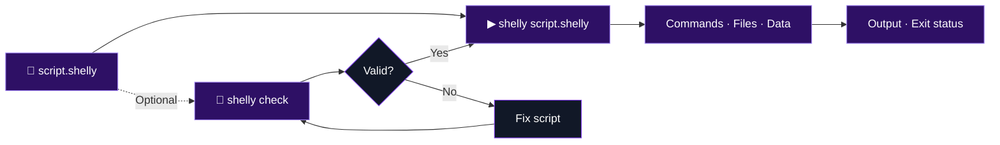

<div align="center">


### A modern scripting language for readable automation.

**Write clear scripts. Automate real work. Go beyond Bash.**

[](https://github.com/Soyagvs/shelly/releases)
[](https://github.com/Soyagvs/shelly/releases)
[](https://github.com/Soyagvs/shelly/stargazers)
[](LICENSE)
[](https://www.rust-lang.org/)

[**Get started**](#-get-started) · [**Explore the language**](#-the-language) · [**Editor support**](#-editor-support) · [**Documentation**](#-documentation) · [**Releases**](https://github.com/Soyagvs/shelly/releases/latest)

</div>

---

## ✦ Why Shelly?

Shell scripts are useful. They can also become difficult to read, validate, and maintain as they grow.

**Shelly** brings a consistent syntax to everyday automation: files, system commands, structured data, interactive menus, and reusable modules. Scripts use the **`.shelly`** extension, and the interpreter is built in **Rust**.

<table>
<tr>
<td width="50%" valign="top">

**◈ Readable by design**

Variables, conditionals, loops, and functions in a clear, explicit syntax.

</td>
<td width="50%" valign="top">

**◇ Optional validation**

Use <code>shelly check</code> when you want to validate a script without executing its commands; running a script directly does not require this step.

</td>
</tr>
<tr>
<td valign="top">

**⌘ Built for automation**

Run system commands, capture output and status, and work with files.

</td>
<td valign="top">

**▣ More than plain text**

Lists, dictionaries, nested values, JSON helpers, and modules.

</td>
</tr>
</table>

## ⚡ Get started

**Latest release featured in this README: `v3.2.0`** · [Download release assets](https://github.com/Soyagvs/shelly/releases/latest)

<details open>
<summary><strong>Linux / macOS</strong></summary>

```sh
curl -fsSL https://raw.githubusercontent.com/Soyagvs/shelly/main/install.sh | sh
```

When needed, the installer adds its directory to your `PATH` in the supported shell profile (`~/.bashrc` or `~/.zshrc`). Open a new terminal, or source the profile named by the installer. For Fish or another unsupported/unknown shell, the installer does not edit profiles automatically; it prints the exact fallback command for the selected `INSTALL_DIR` (use `fish_add_path` in Fish or an `export PATH` command in a POSIX-compatible shell).

</details>

<details>
<summary><strong>Windows (PowerShell)</strong></summary>

```powershell
irm https://raw.githubusercontent.com/Soyagvs/shelly/main/install.ps1 | iex
```

</details>

> [!TIP]
> Prefer to inspect installation scripts first? Read [install.sh](install.sh) or [install.ps1](install.ps1), or download a binary from [Releases](https://github.com/Soyagvs/shelly/releases/latest).

Create **`hello.shelly`**:

````shelly
shellout "Hello from Shelly"

shellout ```
Hello
from multiple lines
```
````

Run it directly, or validate it first without executing commands:

```sh
# Optional validation
shelly check hello.shelly

# Run the script
shelly hello.shelly
```

## 🐦‍⬛ The language

Here's a taste of Shelly's syntax and its scripting features:

```shelly
$name = "Agustin"
$APP = "Shelly"
$names = ["Ana", "Luis", "Mora"]

shellout "Hello $name from $APP"
shellout "First name: $names[first]"

choose "Continue?" ["yes", "no"] -> $answer
if $answer != "yes" or not contains $names "Luis"
    exit 1
end

if exists "README.md"
    shellout "README found"
end

case $answer
    when "yes"
        shellout "continuing"
    else
        shellout "stopping"
end

command "pwd" -> $cwd
command "printf 'warning\n' >&2; exit 7" -> $out, $err, $code
shellout "Running from $cwd"
shellout "last command code: $code stderr: $err"
exit 0
```

### How a script flows



*This is a usage workflow, not a diagram of Shelly's internal parser architecture.*

### Language at a glance

| Building blocks | What you can use |
| :--- | :--- |
| **Values** | Variables, constants, strings, lists, dictionaries, nested values |
| **Flow control** | `if`, `elif`, `else`, `case`, `repeat`, `while`, `for` |
| **Functions** | `call`, `return`, `break`, `continue` |
| **Conditions** | `and`, `or`, `not`, `exists`, `contains` |
| **Automation** | File helpers, logs, menus, commands, arguments, modules |
| **Processes** | Capture `stdout`, `stderr`, and exit code |
| **Structured data** | JSON helpers |

<details>
<summary><strong>Syntax essentials</strong></summary>

- `$name` — mutable variable; `$NAME` — immutable constant.
- `->` — bind a result to a variable.
- `end` — close a block.
- Commas separate normal arguments.
- List indexing starts at `1`.
- `exit 0` means success; `exit 1` means failure.

</details>

### Script arguments

```sh
shelly script.shelly Ada --dry-run
```

```shelly
arg 1 -> $name
hasArg "--dry-run" -> $dryrun
args -> $all
```

## 🧩 Editor support

| Editor / resource | Integration |
| :--- | :--- |
| **VS Code** | [Shelly VS Code extension](https://github.com/Soyagvs/shelly-vscode) — diagnostics and editing support |
| **Neovim** | [Syntax and icons](editors/nvim) |
| **File icons** | [Icon setup guide](docs/file-icons.md) |
| **Artwork** | [Shelly SVG](shelly.svg) |

## 📚 Documentation

**Start with the [Language Guide](docs/language.md)**, then jump to the topic you need.

<details>
<summary><strong>Language basics</strong></summary>

[Overview](docs/language.md) · [Comments](docs/comments.md) · [Variables](docs/variables.md) · [Constants](docs/constants.md) · [Strings](docs/strings.md) · [Numeric expressions](docs/numeric-expressions.md) · [Lists](docs/lists.md) · [Dictionaries](docs/dictionaries.md) · [JSON](docs/json.md)

</details>

<details>
<summary><strong>Control flow and functions</strong></summary>

[Conditionals](docs/conditionals.md) · [Predicates](docs/predicates.md) · [Repeat](docs/repeat.md) · [While](docs/while.md) · [For](docs/for.md) · [Functions](docs/functions.md) · [Error handling](docs/errors.md) · [Exit](docs/exit.md)

</details>

<details>
<summary><strong>Automation and tooling</strong></summary>

[Commands and input](docs/commands.md) · [Files](docs/files.md) · [Logging](docs/logging.md) · [Choose menus](docs/choose.md) · [Standard helpers](docs/helpers.md) · [Modules](docs/modules.md) · [Project structure](docs/project-structure.md) · [File icons](docs/file-icons.md)

</details>

## 📦 Platforms and development

<details>
<summary><strong>Manual downloads</strong></summary>

Get the appropriate archive from [Releases](https://github.com/Soyagvs/shelly/releases/latest):

| Platform | Asset |
| :--- | :--- |
| Linux x86_64 | `shelly-linux-x86_64.tar.gz` |
| macOS Intel | `shelly-macos-x86_64.tar.gz` |
| macOS Apple Silicon | `shelly-macos-arm64.tar.gz` |
| Windows x86_64 | `shelly-windows-x86_64.zip` |

</details>

<details>
<summary><strong>Run from source and development checks</strong></summary>

```sh
cargo run -- path/to/script.shelly
cargo fmt --check
cargo test
```

</details>

---

<div align="center">

### Build something with Shelly.

**[Read the docs](docs/language.md)** · **[Try the latest release](https://github.com/Soyagvs/shelly/releases/latest)** · **[Explore the source](https://github.com/Soyagvs/shelly)**

<sub>Made with Rust · Licensed under <a href="LICENSE">MIT</a></sub>

</div>
